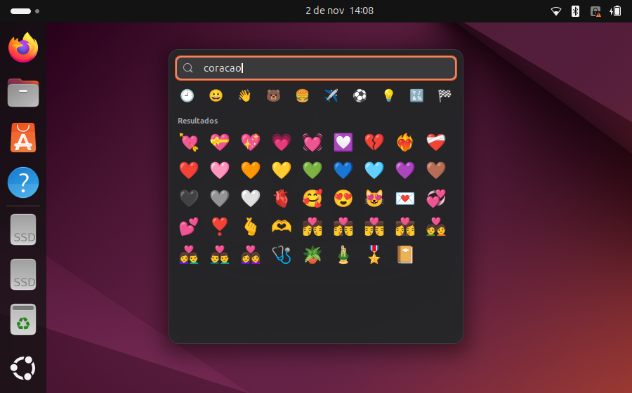

# Emoji Panel para GNOME

Um painel de emoji no estilo do Windows (`Win + .`) para o GNOME Shell no Wayland.



- **Ctrl + .** abre o painel na hora, perto do cursor de texto
- **Pesquisa em português e inglês**: é só começar a digitar (`fogo`, `fire`, `kkk`, `brasil`…), e Enter insere o primeiro resultado
- **Enter com a busca vazia** insere o emoji mais recente, para repetir o último sem tirar a mão do teclado
- **Cada clique insere o emoji direto** no app em que você está digitando, e o painel continua aberto
- **Clique fora ou Esc** fecha
- Abas com os emojis usados recentemente e todas as categorias; passe o mouse para ver o nome do emoji

## Por que uma extensão?

No Wayland, um app comum (Emote, GNOME Characters…) só consegue colar em outra janela saindo da frente dela, então ele fecha a cada emoji ou fica piscando. Este painel roda dentro do próprio GNOME Shell, como o teclado virtual, e não rouba o foco do teclado. O emoji vai pelo método de entrada (o mesmo caminho do teclado virtual) e, nos apps que não suportam isso, por um Ctrl+V virtual que devolve sua área de transferência logo depois.

A barra de pesquisa precisa do teclado enquanto você digita nela; ao escolher um emoji, o foco volta para o app antes de inserir.

## Instalação

Requer GNOME Shell 46 (Ubuntu 24.04).

```bash
git clone https://github.com/joabzicg/gnome-emoji-panel.git
cd gnome-emoji-panel
./install.sh
```

Depois saia da sessão e entre de novo (no Wayland o GNOME só carrega extensões novas no login).

## Configuração

Trocar o atalho:

```bash
gsettings --schemadir ~/.local/share/gnome-shell/extensions/emoji-panel@joab/schemas \
  set org.gnome.shell.extensions.emoji-panel toggle-panel "['<Super>period']"
```

Se outro atalho do sistema também usar `Ctrl + .`, remova-o em Configurações → Teclado → Atalhos de teclado.

## Atualizar a lista de emojis

A lista vem do `emoji-test.txt` do Unicode, e os nomes e palavras-chave da pesquisa vêm do CLDR:

```bash
curl -O https://unicode.org/Public/emoji/latest/emoji-test.txt
CLDR=https://raw.githubusercontent.com/unicode-org/cldr-json/main/cldr-json
for l in pt en; do
  curl -o $l.json $CLDR/cldr-annotations-full/annotations/$l/annotations.json
  curl -o $l-derived.json $CLDR/cldr-annotations-derived-full/annotationsDerived/$l/annotations.json
done
python3 tools/build_emojis.py emoji-test.txt emoji-panel@joab --max-version 15.1 \
  --annotations pt=pt.json,pt-derived.json --annotations en=en.json,en-derived.json
```

`--max-version` é a versão máxima de emoji que a sua fonte desenha (o Noto Color Emoji do Ubuntu 24.04 vai até a 15.1). A primeira língua dá os nomes mostrados no painel; todas entram na pesquisa.

## Licença

GPL-2.0-or-later (veja [LICENSE](LICENSE)). A lista de emojis e os nomes vêm dos dados do Unicode e do CLDR, distribuídos sob a [Unicode License v3](LICENSE-UNICODE.txt).
